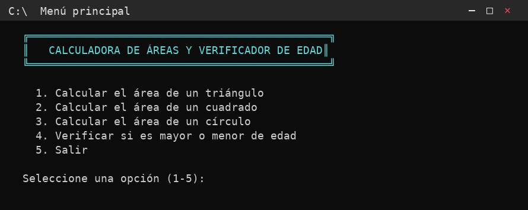
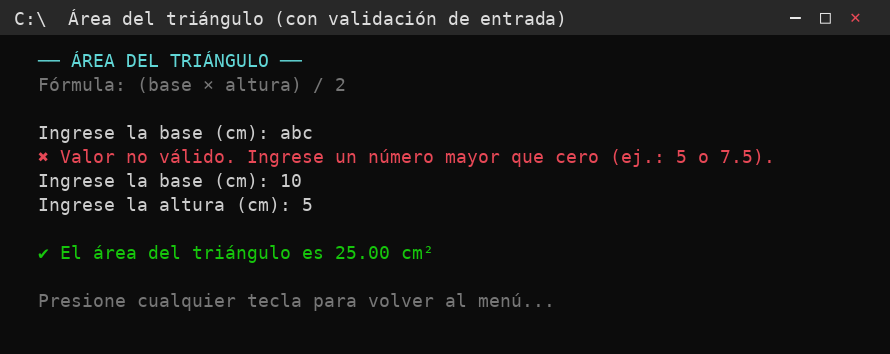
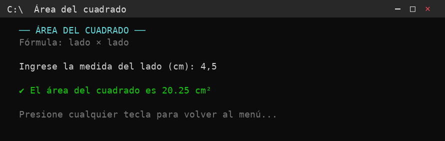
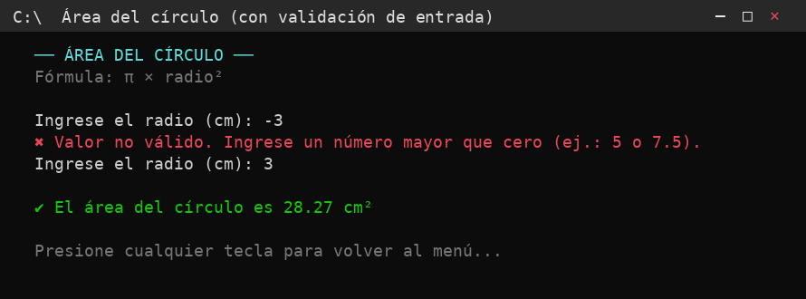
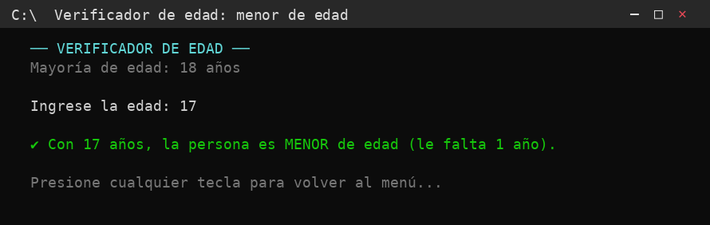
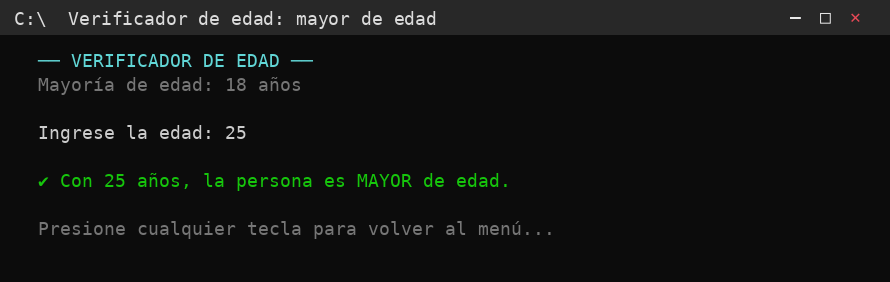
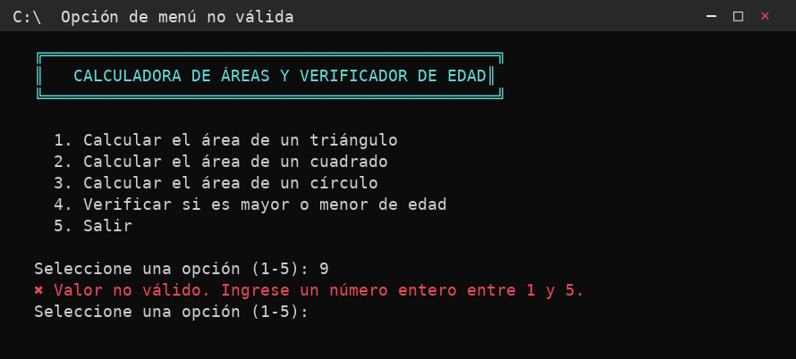
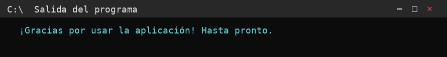

# Calculadora de Áreas y Verificador de Edad

**Asignatura:** Algoritmos Computacionales  
**Actividad:** Control de flujo de una aplicación (Tarea 2)  
**Profesor:** Gamalier Reyes del Carmen  
**Lenguaje:** C# (.NET 8, aplicación de consola)

## Autor(es)

| Nombre | Matrícula |
|---|---|
| [NOMBRE COMPLETO] | [MATRÍCULA] |

## Descripción

Aplicación de consola en C# que muestra un menú interactivo con cuatro operaciones: calcular el área de un **triángulo**, de un **cuadrado** y de un **círculo**, y verificar si una persona es **mayor o menor de edad**. Cada operación está implementada en una función que recibe parámetros y retorna un resultado, y el programa principal (`Main`) invoca esas funciones con los valores que ingresa el usuario.

Para mejorar la usabilidad, el programa:

- Muestra un menú claro que se repite hasta que el usuario elige **Salir**.
- Indica la fórmula de cada cálculo y la unidad de medida (cm).
- **Valida todas las entradas**: si el usuario escribe letras, números negativos o una opción fuera del menú, muestra un mensaje en rojo y vuelve a pedir el dato, sin cerrar el programa.
- Acepta decimales con punto o con coma (`7.5` o `7,5`).
- Usa colores: cian para títulos, verde para resultados y rojo para errores.

## Datos de entrada

| Opción | Dato que se solicita | Tipo | Validación |
|---|---|---|---|
| Menú | Opción elegida | Entero | Entre 1 y 5 |
| 1. Triángulo | Base y altura (cm) | Decimal | Mayor que cero |
| 2. Cuadrado | Medida del lado (cm) | Decimal | Mayor que cero |
| 3. Círculo | Radio (cm) | Decimal | Mayor que cero |
| 4. Edad | Edad de la persona | Entero | Entre 0 y 120 |

## Datos que procesa

| Función | Parámetros | Proceso | Retorno |
|---|---|---|---|
| `CalcularAreaTriangulo` | `double baseTriangulo, double altura` | (base × altura) / 2 | `double` |
| `CalcularAreaCuadrado` | `double lado` | lado × lado | `double` |
| `CalcularAreaCirculo` | `double radio` | π × radio² (usa `Math.PI`) | `double` |
| `VerificarMayoriaDeEdad` | `int edad` | Compara la edad con 18 años | `string` (mensaje) |

Funciones y procedimientos de apoyo:

- `LeerNumeroPositivo` y `LeerEntero`: leen y validan los datos del usuario.
- `MostrarMenu`, `MostrarEncabezado`, `MostrarResultado`, `MostrarError`, `Pausar` y `MostrarDespedida`: muestran la información en pantalla.
- `OpcionTriangulo`, `OpcionCuadrado`, `OpcionCirculo` y `OpcionEdad`: piden los datos, invocan la función de cálculo y muestran el resultado.

## Datos de salida

- Área del triángulo, del cuadrado o del círculo en cm², con dos decimales.
- Mensaje que indica si la persona es mayor o menor de edad y, si es menor, cuántos años le faltan.
- Mensajes de error cuando un dato no es válido.

## Capturas de pantalla

### 1. Menú principal


### 2. Área del triángulo (con un dato no válido)


### 3. Área del cuadrado (decimal con coma)


### 4. Área del círculo (con un número negativo)


### 5. Verificador de edad: menor de edad


### 6. Verificador de edad: mayor de edad


### 7. Opción de menú no válida


### 8. Salida del programa


## Cómo ejecutar el programa

Requisito: tener instalado el [SDK de .NET 8](https://dotnet.microsoft.com/download).

```bash
cd ControlDeFlujo
dotnet run
```

También puede abrirse el archivo `ControlDeFlujo/ControlDeFlujo.csproj` en Visual Studio y ejecutarse con **F5**.

## Estructura del repositorio

```
├── ControlDeFlujo/
│   ├── ControlDeFlujo.csproj
│   └── Program.cs
├── capturas/
│   └── cap_01_menu.png … cap_08_salir.png
├── .gitignore
└── README.md
```
